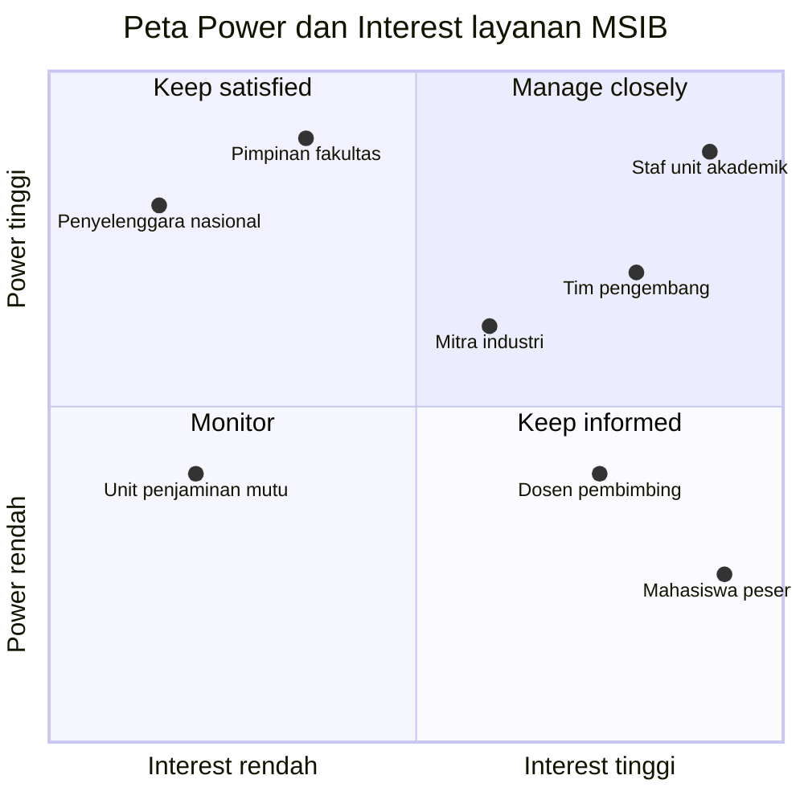

# A2. Stakeholder dan Peta Power/Interest

## Stakeholder register

| No | Stakeholder | Kelompok | Kepentingan terhadap layanan MSIB | Power | Interest | Strategi |
|---|---|---|---|---|---|---|
| 1 | Mahasiswa peserta MSIB | Pengguna | Mendaftar, mengisi logbook, mengikuti bimbingan, dan menerima hasil penilaian | Rendah | Tinggi | Keep informed |
| 2 | Dosen pembimbing | Pengguna | Memantau logbook, memberi bimbingan, dan memberi penilaian | Sedang | Tinggi | Keep informed |
| 3 | Staf unit akademik atau koordinator MSIB | Pemilik layanan | Mengelola pendaftaran, penempatan mitra, dan rekap nilai | Tinggi | Tinggi | Manage closely |
| 4 | Pimpinan fakultas atau program studi | Sponsor | Menyetujui kebijakan dan anggaran, serta menjaga mutu program | Tinggi | Sedang | Keep satisfied |
| 5 | Mitra industri (penyelenggara magang dan pembimbing lapangan) | Mitra eksternal | Menerima peserta, memantau kegiatan, dan memberi penilaian lapangan | Sedang | Sedang | Manage closely |
| 6 | Tim pengembang dan pengelola TI | Teknis | Membangun, mengoperasikan, dan merawat sistem | Sedang | Tinggi | Manage closely |
| 7 | Penyelenggara program MSIB tingkat nasional | Regulator | Menetapkan aturan program dan data yang harus dilaporkan | Tinggi | Rendah | Keep satisfied |
| 8 | Unit penjaminan mutu | Regulator | Memeriksa kesesuaian proses dan bukti penilaian | Sedang | Rendah | Monitor |

Kelima kelompok yang dipakai: pengguna, pemilik dan sponsor, mitra eksternal, teknis, dan regulator.

## Peta power/interest

Gambar PNG untuk laporan ada di `diagram/A2-peta-power-interest.png` (sumber: `diagram/A2-peta-power-interest.drawio`).
