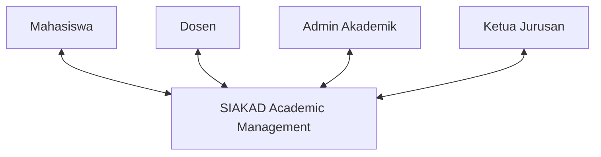
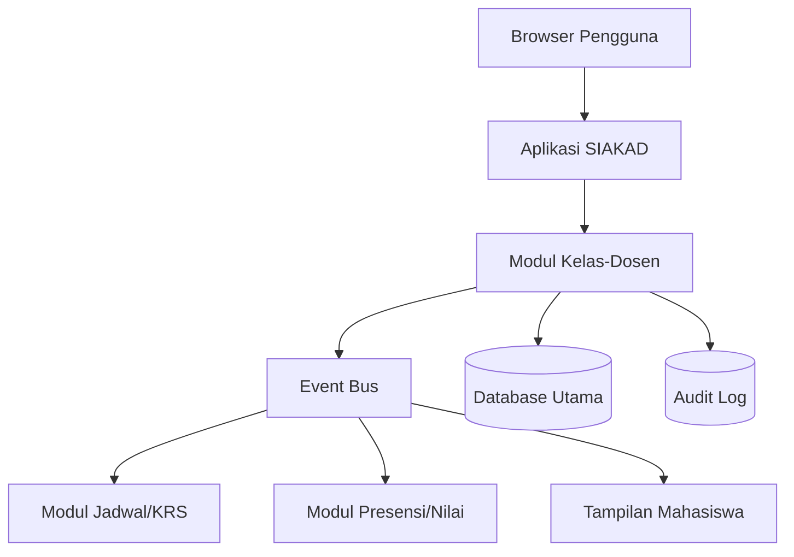
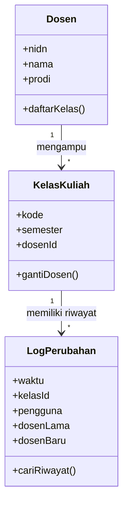

# BAB 5: DIAGRAM SISTEM

## [U5] Diagram Konteks, Arsitektur, dan UML

Pada bab ini dijelaskan rancangan sistem pada subsistem *Academic Management* SIAKAD UMI. Rancangan ini berfokus pada proses penggantian dosen pengampu mata kuliah, mulai dari hubungan sistem dengan pengguna, susunan komponen arsitektur, hingga struktur kelas yang digunakan dalam sistem.

Terdapat tiga diagram utama yang digunakan, yaitu Diagram Konteks, Diagram Arsitektur, dan UML Class Diagram. Ketiga diagram tersebut memberikan gambaran mengenai bagaimana sistem bekerja, bagaimana komponen saling terhubung, serta bagaimana data penggantian dosen pengampu dikelola.

---

## 5.1 Diagram Konteks

Diagram konteks merupakan gambaran umum yang menunjukkan hubungan antara sistem SIAKAD dengan pihak-pihak yang terlibat di dalamnya. Diagram ini menjelaskan aliran informasi antara sistem dengan pengguna yang memiliki peran berbeda.

Pada sistem penggantian dosen pengampu, terdapat empat aktor utama, yaitu:

1. **Mahasiswa:** Mengakses informasi jadwal kuliah dan mengetahui dosen pengampu yang telah diperbarui.
2. **Dosen:** Mengakses informasi kelas yang menjadi tanggung jawabnya serta melihat data kelas yang diampu.
3. **Admin Akademik:** Mengelola data akademik, termasuk melakukan perubahan dosen pengampu pada suatu kelas.
4. **Ketua Jurusan:** Berperan dalam memberikan persetujuan terhadap perubahan dosen pengampu.

Sistem SIAKAD berfungsi sebagai pusat pengelolaan informasi yang menghubungkan seluruh aktor tersebut. Setiap perubahan dosen pengampu akan dikelola oleh sistem agar informasi yang diterima oleh pengguna sesuai dengan data terbaru.

### Diagram Konteks



---

## 5.2 Diagram Arsitektur

Diagram arsitektur menggambarkan susunan komponen sistem SIAKAD serta hubungan komunikasi antara satu komponen dengan komponen lainnya. Arsitektur ini dirancang agar perubahan dosen pengampu dapat disebarkan ke berbagai modul secara terstruktur.

Komponen utama dalam diagram arsitektur meliputi:

1. **Browser Pengguna:** Menjadi media yang digunakan mahasiswa, dosen, dan admin untuk mengakses sistem SIAKAD.
2. **Aplikasi SIAKAD:** Menangani permintaan pengguna dan menghubungkan antarmuka dengan modul yang tersedia.
3. **Modul Kelas-Dosen:** Mengelola data kelas kuliah dan informasi dosen pengampu, termasuk proses penggantian dosen.
4. **Event Bus:** Menjadi media penyebaran informasi perubahan dosen pengampu ke modul-modul lain.
5. **Modul Jadwal/KRS:** Menerima perubahan data dosen yang berkaitan dengan jadwal kuliah dan Kartu Rencana Studi.
6. **Modul Presensi/Nilai:** Mengelola informasi presensi dan hak input nilai berdasarkan dosen pengampu terbaru.
7. **Tampilan Mahasiswa:** Menampilkan informasi dosen pengampu terbaru kepada mahasiswa.
8. **Database Utama:** Menyimpan data utama sistem, termasuk data kelas dan dosen pengampu.
9. **Audit Log:** Menyimpan riwayat perubahan dosen pengampu untuk keperluan pemeriksaan dan penelusuran.

Dengan arsitektur tersebut, perubahan dosen pengampu tidak perlu dilakukan secara manual pada setiap modul. Modul Kelas-Dosen menjadi sumber perubahan, kemudian informasi disebarkan melalui Event Bus agar komponen lain dapat memperbarui datanya.

### Diagram Arsitektur



---

## 5.3 UML Class Diagram

UML Class Diagram merupakan diagram yang menggambarkan struktur kelas, atribut, metode, serta hubungan antar kelas dalam sistem. Diagram ini digunakan untuk menjelaskan bagaimana data dosen, kelas kuliah, dan riwayat perubahan dosen pengampu dikelola.

Pada rancangan ini terdapat tiga kelas utama, yaitu:

### 5.3.1 Class Dosen

Kelas Dosen digunakan untuk menyimpan informasi mengenai dosen yang terdaftar dalam sistem.

- **Atribut:**
  1. `nidn`: Menyimpan nomor induk dosen nasional.
  2. `nama`: Menyimpan nama dosen.
  3. `prodi`: Menyimpan program studi dosen.

- **Method:**
  1. `daftarKelas()`: Menampilkan daftar kelas kuliah yang diampu oleh dosen.

### 5.3.2 Class KelasKuliah

Kelas KelasKuliah digunakan untuk menyimpan informasi mengenai kelas perkuliahan dan dosen yang bertanggung jawab mengampu kelas tersebut.

- **Atribut:**
  1. `kode`: Menyimpan kode kelas kuliah.
  2. `semester`: Menyimpan informasi semester perkuliahan.
  3. `dosenId`: Menyimpan identitas dosen pengampu.

- **Method:**
  1. `gantiDosen()`: Digunakan untuk melakukan perubahan dosen pengampu pada suatu kelas kuliah.

### 5.3.3 Class LogPerubahan

Kelas LogPerubahan digunakan untuk menyimpan riwayat perubahan dosen pengampu agar setiap perubahan dapat diketahui dan ditelusuri kembali.

- **Atribut:**
  1. `waktu`: Menyimpan waktu terjadinya perubahan.
  2. `kelasId`: Menyimpan identitas kelas yang mengalami perubahan.
  3. `pengguna`: Menyimpan identitas pengguna yang melakukan perubahan.
  4. `dosenLama`: Menyimpan informasi dosen pengampu sebelumnya.
  5. `dosenBaru`: Menyimpan informasi dosen pengampu yang baru.

- **Method:**
  1. `cariRiwayat()`: Digunakan untuk mencari dan menampilkan riwayat perubahan dosen pengampu.

### 5.3.4 Hubungan Antar Kelas

Hubungan antar kelas pada UML Class Diagram dijelaskan sebagai berikut:

1. **Dosen dengan KelasKuliah:** Satu dosen dapat mengampu banyak kelas kuliah, sedangkan satu kelas kuliah memiliki satu dosen pengampu.
2. **KelasKuliah dengan LogPerubahan:** Satu kelas kuliah dapat memiliki banyak catatan perubahan dosen pengampu, sedangkan setiap catatan perubahan berkaitan dengan satu kelas kuliah.

### Diagram UML Class



---

## 5.4 Kesimpulan

Berdasarkan ketiga diagram yang telah dijelaskan, rancangan sistem penggantian dosen pengampu pada subsistem Academic Management SIAKAD UMI terdiri dari hubungan antara sistem dengan aktor, susunan komponen arsitektur, serta struktur kelas yang mengelola data.

Diagram Konteks menunjukkan pihak-pihak yang berinteraksi dengan sistem. Diagram Arsitektur menjelaskan bagaimana komponen dan modul saling terhubung dalam proses penyebaran perubahan data. Sementara itu, UML Class Diagram menggambarkan struktur data dosen, kelas kuliah, dan riwayat perubahan.

Ketiga diagram tersebut menjadi dasar dalam memahami rancangan sistem agar proses penggantian dosen pengampu dapat dikelola dengan lebih terstruktur dan informasi yang ditampilkan sesuai dengan perubahan terbaru.
```
